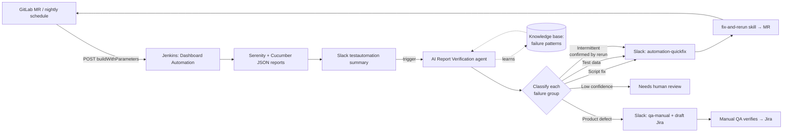
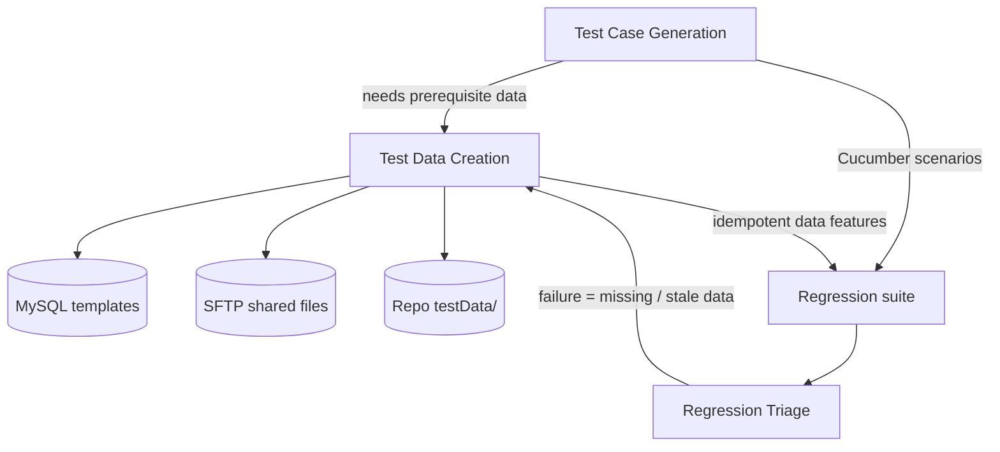

# SDET Morning Helper AI ☀️

**By the time the team says good morning, last night’s regression is already triaged.**

> Agentic AI skills layered on top of a Java · Cucumber · Serenity · Selenium framework that **verify every nightly regression report, classify each failure, route it to the right team, generate test cases from specs, and create the test data they need** — wired into GitLab CI and Jenkins.

       

**Live site:** `https://<your-github-username>.github.io/SDET-Morning-Helper-AI/`

---

## The problem

A large UI regression suite (~25 product modules, several production regions) runs every night. Every morning someone had to open the Serenity report, read each failure, decide *is this our script, our data, a flaky run or a real product bug?*, fix or rerun, and tell the manual QA team about real defects. That took hours, and the answer depended on who did it.

## What I built

| # | Component | What it does | Deep dive |
|---|---|---|---|
| 1 | **AI Report Verification & Routing** | When the nightly report lands in Slack, an AI agent verifies it, classifies every failure into *Script fix · Test data · Intermittent · Environment · Product defect*, and posts the first three to **#automation-quickfix** and defects to **#qa-manual** | [case-studies/01](case-studies/01-ai-report-verification.md) |
| 2 | **Regression Triage skill** | Groups failures by root-cause signature, traces each one step → page method → locator, attaches evidence and a confidence level, and writes two reports (automation / manual QA) | [case-studies/02](case-studies/02-regression-triage.md) |
| 3 | **Test Case Generation skill** | Turns a Confluence/PRD page (and optional manual cases) into a traceable case set in the order *Positive → Edge → Negative → State → Non-functional*, then automates it with existing steps | [case-studies/03](case-studies/03-test-case-generation.md) |
| 4 | **Test Data Creation skill** | Detects the prerequisite data a case needs, adds it to an idempotent *Test Data Creation* suite, and stores it in **JDBC (MySQL)**, **SFTP** or the **repo** based on clear rules | [case-studies/04](case-studies/04-test-data-creation.md) |
| 5 | **GitLab CI → Jenkins Test stage** | A `test` stage in GitLab CI calls Jenkins over REST to run only the **pod-wise** suites affected by a code fix, and reports the result back on the merge request | [case-studies/05](case-studies/05-gitlab-ci-jenkins-trigger.md) |

## End-to-end flow



## How the pieces connect



## Design principles

- **Evidence before verdict.** No failure is called a product defect without the assertion's expected vs actual, a screenshot or an API response. Low confidence → *Needs human review*.
- **Group by signature, not by scenario.** 40 failures usually come from 5–8 root causes.
- **Confirm flakiness, don't guess it.** "Intermittent" is assigned only after an automatic rerun passes.
- **Humans approve outward actions.** Slack posts and Jira tickets are drafted by the agent; pushing code and creating tickets stay behind approval.
- **The system learns.** Every confirmed pattern (flaky scenario, known bug ↔ ticket, misclassification) is written to a knowledge book the next run reads first.
- **Secrets never leave the vault.** Credentials are read through permission prompts and environment variables, never echoed into reports, logs or commits.

## Repository layout

```
├── case-studies/          # one write-up per component, with diagrams
├── examples/
│   ├── skills/            # sanitised AI skill definitions (SKILL.md + rules)
│   ├── report-router/     # Slack routing logic for classified failures (Python)
│   ├── ci/                # GitLab CI test stage → Jenkins trigger
│   └── sample-reports/    # what the two channels receive
├── docs/                  # GitHub Pages website (index.html)
└── RESUME.md              # resume bullets for this work
```

## Tech stack

Java 17 · Cucumber 7 · Serenity BDD 3.5 · Selenium 4 · Rest Assured · Maven · Jenkins (declarative pipeline, parallel forks) · GitLab CI · MySQL (JDBC) · SFTP · AWS SSM · Slack API · Claude Code (skills, sub-agents, hooks) · Python

## Note on confidentiality

This repository is a **case study**. It contains no proprietary source code, credentials, hostnames or customer data from my employer. Code under `examples/` is re-written and simplified to show the approach.

---

**Author:** Vinay Prasad — QA Automation Engineer · [LinkedIn](https://www.linkedin.com/in/<your-profile>) · [Email](mailto:<your-email>)
