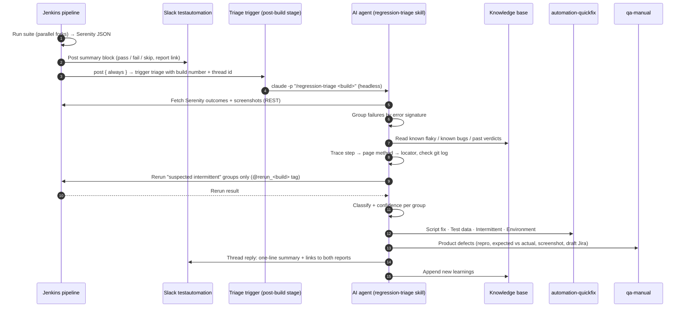

# 1 · AI Report Verification & Failure Routing

**Goal:** every morning, before anyone opens a report, each regression failure is already classified and sitting in the channel of the team that has to act on it.

## Before vs after

| | Before | After |
|---|---|---|
| Who reads the report | One automation engineer, manually | AI agent, minutes after the run ends |
| Output | Ad-hoc Slack message | Two structured reports, routed by category |
| Flaky vs real | Gut feeling | Confirmed by an automatic rerun |
| Defects to manual QA | Sometimes, late | Every time, with repro steps and a draft Jira |
| Memory between runs | None | Knowledge base of known patterns |

## The flow

## Classification (first strong match wins)

| Category | Typical evidence | Goes to | Next action |
|---|---|---|---|
| **Script fix** | `NoSuchElement`/`Timeout` on a locator while the screenshot shows the feature working; wrong dropdown opened; toast read too early; recent commit touched that page | #automation-quickfix | `fix-and-rerun` skill opens a branch, fixes, reruns only those scenarios |
| **Test data issue** | Prerequisite segment/catalog/integration missing, name collision from an earlier run, stale template | #automation-quickfix | `test-data-creation` skill recreates it in the right store |
| **Intermittent** | Same step failed, **passed on automatic rerun**; or listed as flaky in the knowledge base | #automation-quickfix (low priority) | Tracked with a flake counter; fixed when it crosses a threshold |
| **Environment** | Login/session failures, `net::ERR_*`, many unrelated modules failing with one signature | #automation-quickfix (infra tag) | Rerun after infra check |
| **Product defect** | Clear business expected ≠ actual with correct input, error toast, 4xx/5xx, reproduces on rerun | **#qa-manual** | Manual QA confirms → Jira |
| **Needs human review** | Low confidence, conflicting evidence | Both, flagged | A person decides; the verdict is fed back to the knowledge base |

## Improvements I designed into the flow

1. **Rerun-to-confirm for intermittents.** The agent tags only the suspected-flaky scenarios with a temporary `@rerun_<build>` tag and reruns them. Pass → *Intermittent*. Fail again → reclassify as script fix or defect. This removes the most common misclassification.
2. **Confidence gating.** Each verdict carries high / medium / low. Only high/medium are auto-routed; low goes to *Needs human review* with the evidence that would settle it.
3. **Known-issue matching.** Before analysing, failures are matched against the knowledge base (flaky list, open tickets). A known product bug is linked to its existing ticket instead of creating a duplicate.
4. **Feedback loop.** A ✅/❌ reaction or a reply in the channel corrects a verdict; the correction is written back to the knowledge base so the same mistake isn't repeated.
5. **Idempotent trigger.** One triage per build number; reruns of the trigger reuse the previous result.
6. **Flake trend.** Each intermittent increments a per-scenario counter; past a threshold it is promoted to a *Script fix* ticket so flakiness is actually fixed, not just ignored.
7. **Guardrails.** The agent drafts; humans approve Jira creation and code pushes. Secrets are referenced by key name only.

## Message format

See [`examples/sample-reports/`](../examples/sample-reports/) for the exact messages each channel receives.

## Routing logic

See [`examples/report-router/router.py`](../examples/report-router/router.py) — takes the agent's JSON verdict and posts each group to the channel configured for its category.
