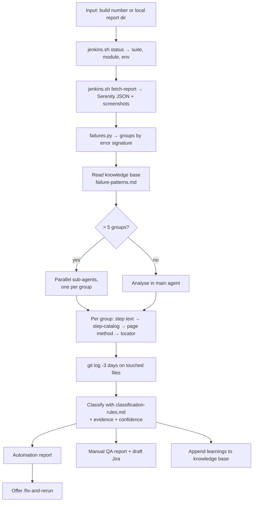
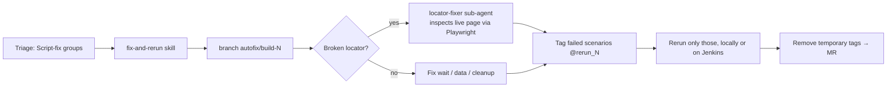

# 2 · Regression Triage Skill

An AI skill (a `SKILL.md` procedure the agent follows) that turns a Jenkins build number into two actionable reports. It is the engine behind the automated report verification in [01](01-ai-report-verification.md), and can also be run on demand: `/regression-triage 17750`.

## Flow

## What makes it reliable

| Technique | Why |
|---|---|
| **Signature grouping** (`failures.py`) normalises error text (strips IDs, timestamps, line numbers) and groups scenarios that fail the same way | Analyse 6 root causes, not 40 scenarios |
| **Code-path tracing** with a step catalog (`step-catalog.py`) that maps every Gherkin step to its Java definition `file:line` | The agent reads the exact locator that failed instead of guessing |
| **Rule table** with ordered, evidence-based rules (see [`examples/skills/regression-triage/classification-rules.md`](../examples/skills/regression-triage/classification-rules.md)) | Same failure → same verdict, regardless of who runs it |
| **Recent-change signal**: a commit touching the failing page in the last 3 days | Strong indicator of an automation regression |
| **Knowledge base** of flaky scenarios, known bugs ↔ ticket IDs, past misclassifications | Each run starts smarter than the last |
| **Two audiences, two reports** | Engineers get file:line and before/after code; manual QA get business language, repro steps and expected vs actual |

## Hand-off to fixing

Guardrails: a product bug is never "fixed" by weakening an assertion; rerun tags are never committed; a compile hook blocks the agent from finishing with broken Java.
