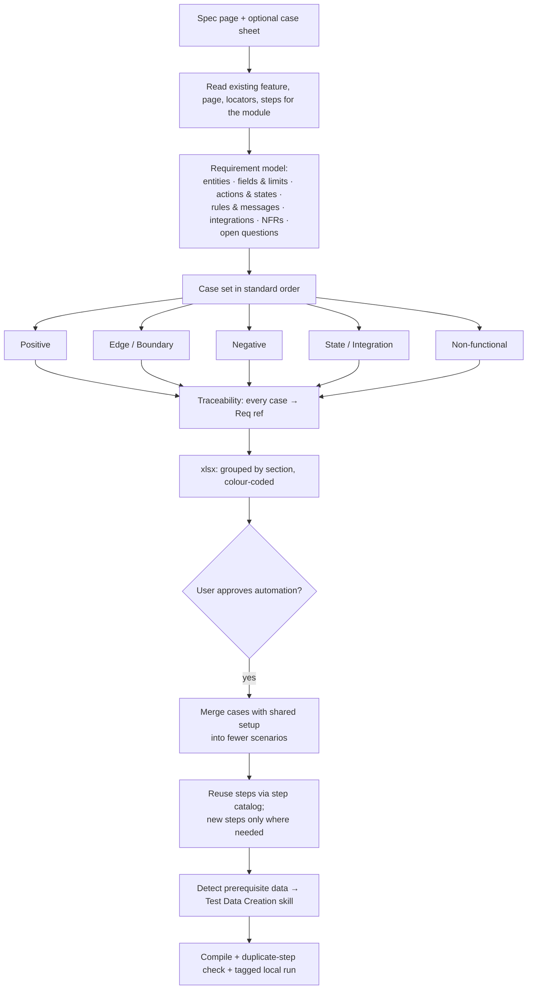

# 3 · Test Case Generation Skill

From a Confluence/PRD page (and, optionally, an existing manual test-case sheet) to a reviewed, traceable case set — and on approval, to Cucumber scenarios that reuse existing steps.

## Two modes

| Mode | Input | Output |
|---|---|---|
| **A — Review & reorder** | Manual cases + spec | Cases checked against the spec, gaps added, duplicates merged, reordered into the standard flow |
| **B — Generate** | Spec only | A full case set derived from the spec |

## Flow

## Rules the skill enforces

- **Never invent requirements.** Ambiguity becomes an *open question*, not an assumption.
- **Observable expected results** — a text, toast, value, state or count; never "works fine".
- **IDs that sort and trace:** `TC_<MODULE>_<P|E|N|S|NF>_<NN>`, each with a `Req ref` and, in mode A, the original `Source ID`.
- **Optimise automation:** cases with the same setup become one scenario with several validations, or a `Scenario Outline`; the skill reports logins/navigations saved.
- **Code conventions:** locators in page-element enums, dropdowns located by their label (never by position), explicit waits only, assertions with expected vs actual, every scenario cleans up the data it creates.
- **Feature file structure:** scenarios grouped under section comments in the same Positive → Non-functional order, with case IDs above each scenario.

## Output

1. Requirement model and open questions
2. Review findings (mode A)
3. Case table by section + counts per section/status
4. Coverage map: case ID → scenario title or "manual: reason"
5. Code diff summary, compile and duplicate-step results
