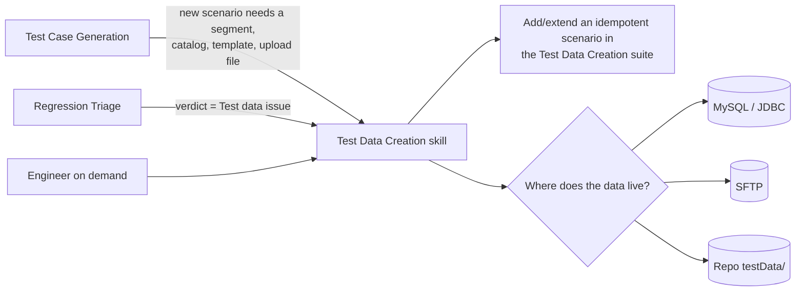
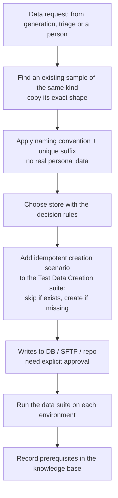

# 4 · Test Data Creation Skill (integrated with Generation & Triage)

Tests fail for missing data as often as for broken code. This skill makes test data a **first-class, versioned, reproducible** part of the suite.

## Where it gets triggered

## Storage decision rules

| Store it in… | When the data is… | Examples | Why |
|---|---|---|---|
| **MySQL (JDBC)** — template DB keyed by scenario name | Structured JSON that differs per scenario or environment, changes often, or is large | Journey templates, campaign payloads, personalisation templates | Update without a code release; one lookup key per scenario; queryable |
| **SFTP** — shared `TestData/` | Files every Jenkins agent must read, binaries or large uploads, data refreshed by a pipeline | `testData.xlsx`, bulk upload CSVs, exported payloads | Shared across agents and parallel forks; too big / too volatile for git |
| **Repo** — `src/test/resources/testData/` | Small, static, reviewed with the code that uses it | Sample CSV headers, a fallback template, XML upload fixtures | Versioned with the test, visible in code review |

The framework reads in a fixed order — **DB → repo → SFTP** — so the skill always tells the engineer which store the new data went to and why.

## Flow

## Improvements I built in

- **Idempotent creation.** Every data scenario checks first and creates only what's missing (e.g. skip event files already uploaded today), so the suite is safe to run daily on every environment.
- **Naming convention as a contract.** Entity names encode their type (e.g. `TOP-`, `PERS-`, `REL-` prefixes for recommendation types), so page logic reads behaviour from the name and renames go through one idempotent rename feature.
- **Shape-copy, never invent.** New templates are cloned from an existing one of the same kind, keeping keys, nesting and types.
- **Synthetic identities only:** `test-user-<n>@…`, `automation-<module>-<n>` user IDs, reserved phone ranges.
- **Approval for remote writes.** `SELECT` is free; any `INSERT/UPDATE/DELETE` or SFTP upload is shown to a person first.
- **Prerequisite flagging.** Integrations, events or attributes that must already exist in the account are listed explicitly, so a missing one is triaged as *Test data* — not as a product bug.
- **Cleanup by default.** Every scenario that creates data ends with an API delete step.
