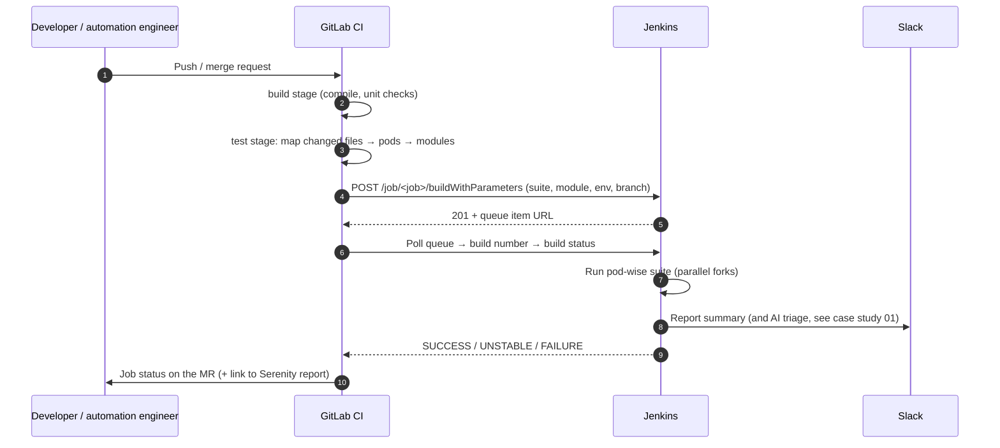

# 5 · GitLab CI Test Stage → Jenkins (pod-wise execution)

A `test` stage in the GitLab pipeline calls Jenkins over REST, so a code fix is validated by the UI suite **of the pods it touches** — not the whole regression.

## Flow

## Pod-wise suites

Modules are grouped by the product pod that owns them, so a change runs only the relevant group:

| Pod | Modules (example) |
|---|---|
| Campaigns | SMS, Email, Push, Web Push, WhatsApp, RCS, Viber, In-App |
| Journeys | Journeys, Relays |
| Personalisation | On-site notification, In-line content, Message personalisation, Catalogs, Recommendations |
| Data & Segments | Users, Live/Static segments, Custom entity, Derived attributes |
| Analytics | Event analytics, Funnels, Custom dashboards, Alerts |

Mapping rule: changed files → module (from the feature/page/locator path) → pod. Framework-level changes (utilities, hooks, runners) → **Smoke on all pods**.

## Design choices

- **Token in CI variables**, masked and protected; never in the YAML.
- **Parameterised build only** — never the remote-token trigger that would start the full universal regression.
- **Non-blocking by default** for nightly schedules, **blocking** for MRs that change automation code.
- **Timeout + clear failure message** if no Jenkins agent is free.

See [`examples/ci/.gitlab-ci.yml`](../examples/ci/.gitlab-ci.yml).
